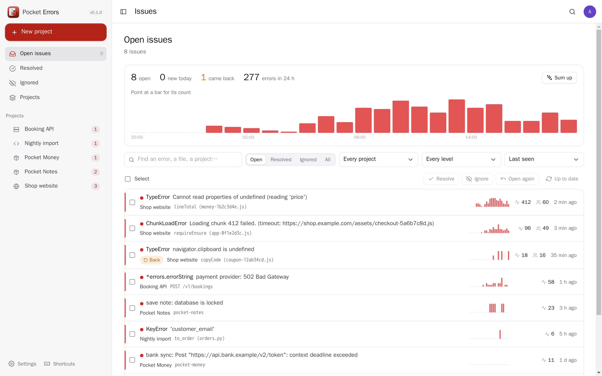
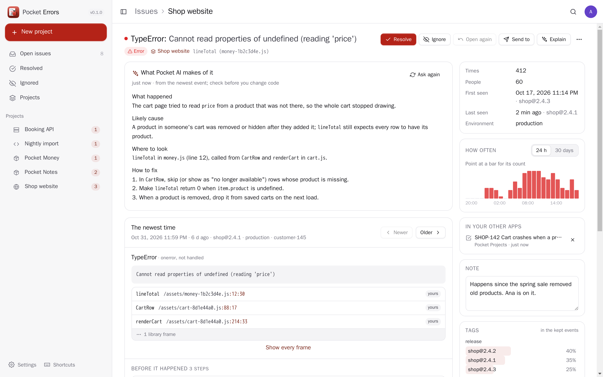
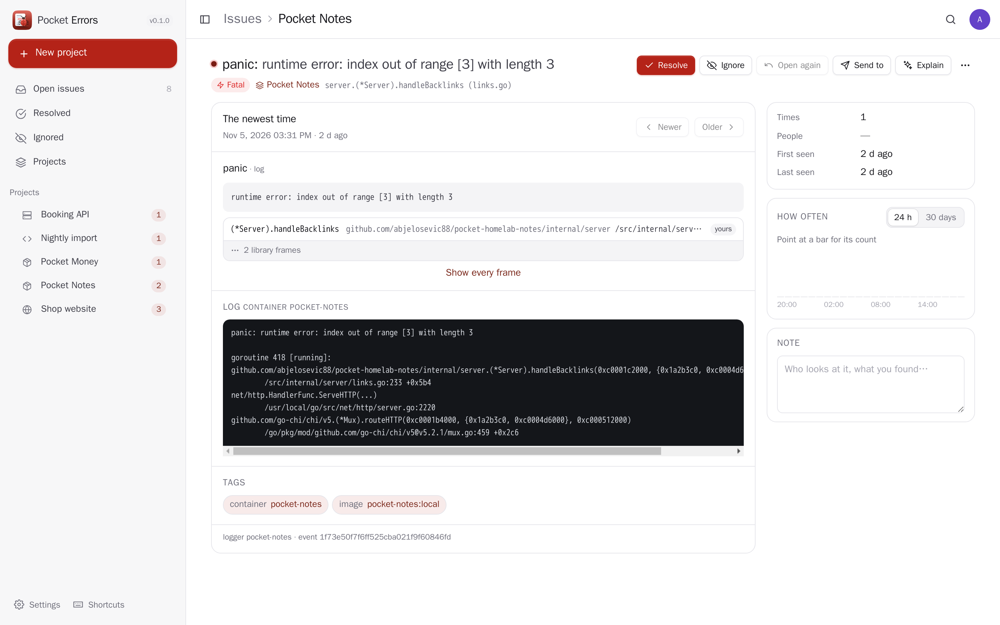
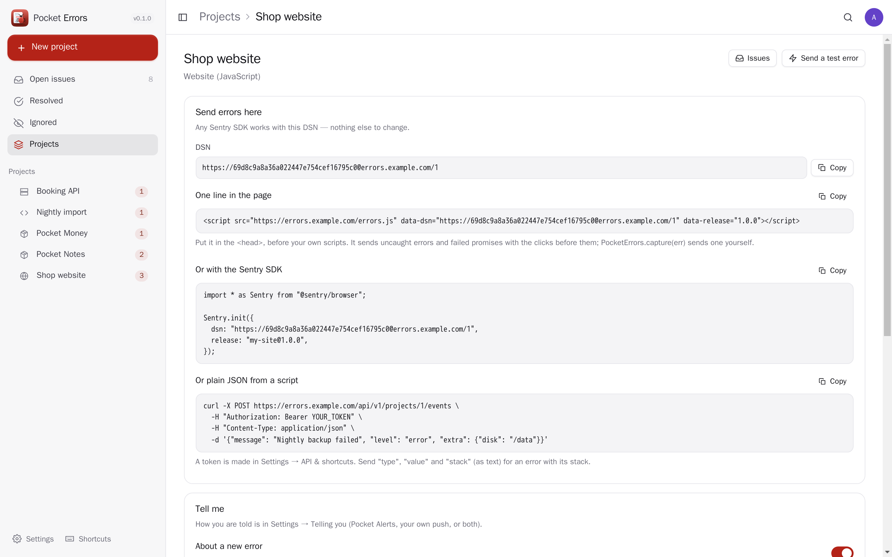
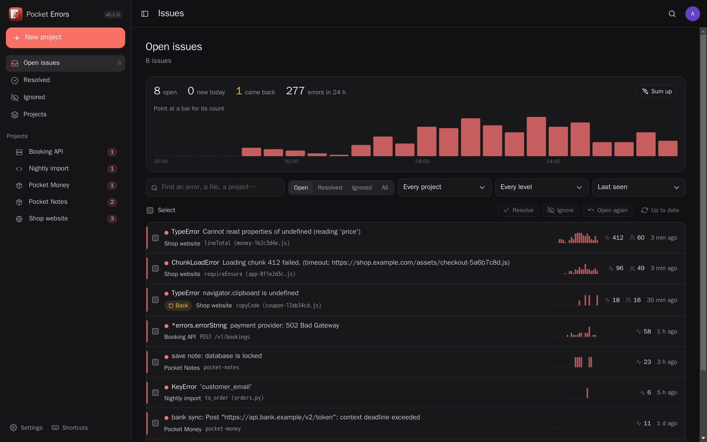
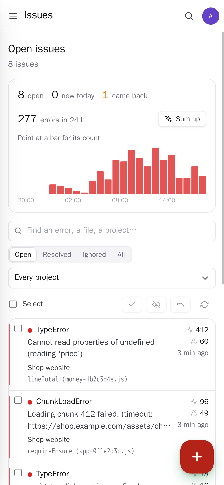
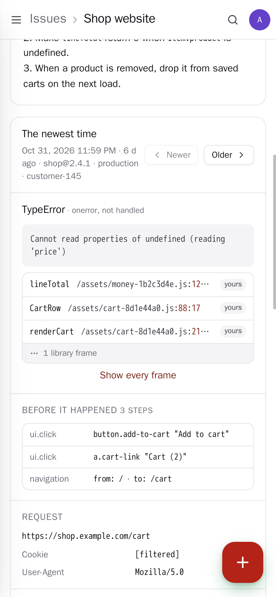

<p align="center"></p>
<h1 align="center">Pocket Errors</h1>
<p align="center">Error tracking for your apps and websites: what broke, where in the code, how often, for how many people and since which release. Any Sentry SDK sends to it unchanged, a website needs one script line, Pocket apps report through Pocket Core — and it can read this box's container logs for errors and panics with nothing to install. Errors that are the same problem become one issue you resolve, ignore or send to Pocket Projects; Pocket AI explains what went wrong and how to fix it.<br>One Go binary, one SQLite file, one volume. Part of the Pocket apps; works on its own too.</p>
<p align="center">
  <a href="https://github.com/abjelosevic88/pocket-homelab-errors/actions"></a>
  <a href="https://github.com/abjelosevic88/pocket-homelab-errors/pkgs/container/pocket-homelab-errors"></a>
  <a href="LICENSE"></a>
</p>

---

<p align="center"></p>

<table>
  <tr>
    <td width="50%"></td>
    <td width="50%"></td>
  </tr>
  <tr>
    <td align="center"><sub>An issue: Pocket AI's explanation, the stack with your own frames first, how often, releases, tags.</sub></td>
    <td align="center"><sub>A Go panic read straight from a Pocket app's container logs.</sub></td>
  </tr>
  <tr>
    <td width="50%"></td>
    <td width="50%"></td>
  </tr>
  <tr>
    <td align="center"><sub>A project: its DSN, the line to paste, and what to be told about.</sub></td>
    <td align="center"><sub>Light and dark follow the system.</sub></td>
  </tr>
  <tr>
    <td width="50%"></td>
    <td width="50%"></td>
  </tr>
  <tr>
    <td align="center"><sub>On the phone: the inbox of what is broken.</sub></td>
    <td align="center"><sub>The stack, the steps before it and the request.</sub></td>
  </tr>
</table>

## What it does

- **Sentry-compatible**: `/api/{project}/store/` and `/envelope/` take what any Sentry SDK sends (browser, Go, Python, Node, …) with the project's DSN — swap the DSN, change nothing else. A website without an SDK uses one `<script src="…/errors.js" data-dsn="…">` line.
- **Grouped into issues**: the same error type in the same code (line numbers and bundle hashes left out) or the same message with its numbers, ids and quoted values left out is one issue. Your own fingerprint wins when you send one.
- **Every issue**: the stack with your own frames first and the library ones folded, code around the line, the clicks, pages and requests before it, the request, the app's user, tags with how they spread, browser and OS, releases first and last seen; event by event.
- **Resolve, ignore, come back**: a resolved issue that happens again is open and marked *back*; ignore for an hour, a day, a week, a month or for good.
- **This box's containers** (admins, the Docker socket mounted read-only): every 15 seconds the logs of `pocket-*` (or whatever names you pick) are read for structured error lines, JSON logs, Go panics and Python tracebacks — every Pocket app's server errors, nothing to change in them. Each container gets its project with its first error.
- **Telling you**: a new issue, one that came back, one happening a lot — per project — through Pocket Alerts (your rules and quiet hours) or your own ntfy/Apprise push; at most 30 an hour.
- **Safe to keep**: passwords, tokens, cookies and keys are filtered out before anything is stored; the app users' addresses too (switch-off-able). 600 errors a minute per project, the newest 200 events per issue, kept 30 days (your choice); counts stay.
- **Pocket AI** (only when you press it): *Explain* — what happened, the likely cause, where to look, how to fix it; *Sum up* — the last 24 hours in a few sentences.
- **Everyone their own** on one box; admins see no one else's errors.

## Run it

```sh
docker run -d --name pocket-errors -p 8080:8080 -v ./data:/data \
  -e BASE_URL=https://errors.example.com -e SECURE_COOKIES=true \
  ghcr.io/abjelosevic88/pocket-homelab-errors:latest
```

or `docker compose up -d` with [docker-compose.yml](docker-compose.yml) (add `-v /var/run/docker.sock:/var/run/docker.sock:ro` to have the containers read). Open it, create the first account, make a project and paste its line. All options: [docs/configuration.md](docs/configuration.md). API: [docs/api.md](docs/api.md). Backups: [docs/backup.md](docs/backup.md).

## With Pocket Core

Set `CORE_URL` and `CORE_REGISTRATION_KEY` and Errors joins the box: people sign in with Pocket Core, Pocket AI explains errors, and through app links it works with your own Pocket apps with nothing to paste:

| App | What for | Scopes |
|---|---|---|
| Pocket Alerts | tell you about new, returning and busy errors | `alerts:write` |
| Pocket Projects | *Send to* → an issue for the team that fixes it, with the stack and a link back | `projects:read`, `projects:write` |
| Pocket Tasks | *Send to* → a task to look into it | `tasks:write` |

**Nothing depends on another app.** Each connection is checked per person and greyed with what to do, never hidden; without Core each can be connected directly with a URL and a token.

Other apps use your errors through `errors:read` and `errors:write`: Pocket AI answers “what broke today?” (`pocket_errors_*` tools in Pocket Core), Pocket Day can show the day (`GET /day/{date}`), Pocket Search finds issues, and any Pocket app can report its own errors (`POST /report`) into a project named after it. Events `errors.issue_new`, `errors.issue_regressed`, `errors.issue_spike` and `errors.issue_resolved` start flows in Pocket Flows.

## Develop

```sh
make dev     # API on :8080 with demo data (a month of made-up errors) + Vite on :5173
make test    # go vet, go test, tsc
make         # web + binary
```

`node scripts/screenshots.mjs` takes the screenshots above from a demo instance and fails on any browser error. MIT licensed.
